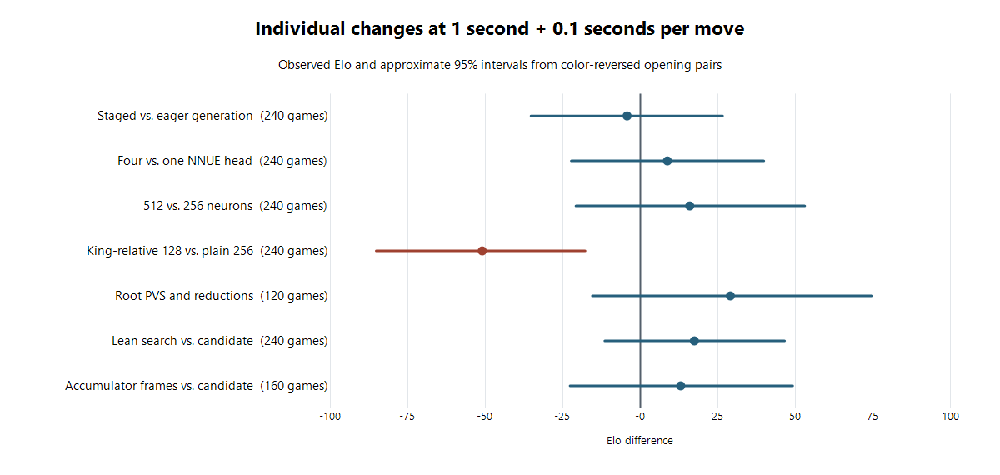

# Overnight search and NNUE tests

Match snapshot at 08:59 Eastern on November 24, 2026.

**Resumed RC1 blitz result.** RC1 passed against 9.0 at 180+1 with 103 wins, 129 draws and 46 losses in 278 games (60.3%, +72.3 observed Elo, LLR +2.992). [9.1 is the corresponding frozen release](../../versions/v9/source_9.1/README.md). The tables below preserve the overnight snapshot.

**Final RC2 blitz result.** RC2 scored 250 wins, 425 draws and 215 losses in 890 games (52.0%, +13.7 observed Elo, LLR +1.223) against 9.1 at 180+1. The three-minute SPRT was closed as inconclusive at promotion. The 445 complete opening pairs gave a descriptive 95% Elo interval of +0.0 to +27.8. [9.2 is the corresponding frozen release](../../versions/v9/source_9.2/README.md).

## Qualified builds

The adaptive-clock branch became **9.0** after it scored 179 wins, 129 draws and 104 losses against 8.3 at 1+0.1 (59.1%, +64.0 observed Elo).

**9.1-rc1** passed its 1+0.1 SPRT against 9.0 at 100 wins, 79 draws and 36 losses (64.9%, +106.7 observed Elo). **9.1-rc2** then passed its independent 1+0.1 SPRT against RC1 at 261 wins, 301 draws and 189 losses (54.8%, +33.4 observed Elo).

- At three minutes plus one second, RC1 against 9.0 scored 101/129/46 W/D/L across 276 games (60.0%). SPRT status is inconclusive at deadline (LLR +2.89 from final W/D/L).
- At three minutes plus one second, RC2 against RC1 scored 3/5/4 W/D/L across 12 games (45.8%). SPRT status is inconclusive at deadline (LLR -0.06 from final W/D/L).

The [RC2 launcher](../9.1-rc2/README.md) can replay its final three-minute score with `run-blitz.ps1 -Resume -Preview`. The [RC1 launcher](README.md) supports its own three-minute continuation and the eight-thread external calibration.

## Match results

Frozen Zebrafish 9.0 is the opponent called base. Internal games used one thread and 64 MiB hash per engine, paired openings, zero move overhead, and disabled books and tablebases. The SPRTs tested 0 against +10 Elo with 5% error rates and likelihood boundaries of ±2.94.

| Match | Clock | Games | W/D/L | Score | Elo | Complete pairs | Paired 95% Elo interval | Decision |
|---|---|---:|---|---:|---:|---:|---|---|
| fast vs base | 1 s + 0.1 s | 600 | 192/214/194 | 49.8% | -1.2 | 298 | -20.4 to +18.1 | inconclusive, stopped for other tests (LLR -0.48 from final W/D/L) |
| heads vs fast | 1 s + 0.1 s | 160 | 55/62/43 | 53.8% | +26.1 | 80 | -17.7 to +70.7 | fixed pilot complete |
| trained vs base | 1 s + 0.1 s | 215 | 100/79/36 | 64.9% | +106.7 | 107 | +68.1 to +145.2 | H1 accepted (LLR +2.97) |
| power vs base | 1 s + 0.1 s | 301 | 123/119/59 | 60.6% | +75.0 | 150 | +44.7 to +104.5 | H1 accepted (LLR +2.95) |
| trained vs base | 3 min + 1 s | 276 | 101/129/46 | 60.0% | +70.2 | 138 | +45.1 to +96.0 | inconclusive at deadline (LLR +2.89 from final W/D/L) |
| trained vs eager | 1 s + 0.1 s | 240 | 70/97/73 | 49.4% | -4.3 | 120 | -35.3 to +26.5 | fixed pilot complete |
| trained vs single256 | 1 s + 0.1 s | 240 | 75/96/69 | 51.2% | +8.7 | 120 | -22.3 to +39.8 | fixed pilot complete |
| wide vs trained | 1 s + 0.1 s | 240 | 81/89/70 | 52.3% | +15.9 | 120 | -20.8 to +53.0 | fixed pilot complete |
| lean vs trained | 1 s + 0.1 s | 240 | 76/100/64 | 52.5% | +17.4 | 120 | -11.5 to +46.5 | fixed pilot complete |
| trained vs rootless | 1 s + 0.1 s | 120 | 42/46/32 | 54.2% | +29.0 | 60 | -15.5 to +74.5 | fixed pilot complete |
| kingsmall vs trained | 1 s + 0.1 s | 240 | 60/85/95 | 42.7% | -51.0 | 120 | -85.2 to -17.8 | fixed pilot complete |
| lean vs trained | 1 s + 0.1 s | 751 | 261/301/189 | 54.8% | +33.4 | 375 | +16.4 to +49.7 | H1 accepted (LLR +2.96) |
| continuation vs power | 1 s + 0.1 s | 2 | 1/0/1 | 50.0% | — | 1 | — | inconclusive, stopped for other tests |
| frames vs trained | 1 s + 0.1 s | 160 | 54/58/48 | 51.9% | +13.0 | 80 | -22.7 to +49.1 | fixed pilot complete |
| lean vs trained | 3 s + 1 s | 2 | 1/0/1 | 50.0% | — | 1 | — | inconclusive, stopped for other tests (LLR -0.00 from final W/D/L) |
| lean vs trained | 3 min + 1 s | 12 | 3/5/4 | 45.8% | — | 6 | — | inconclusive at deadline (LLR -0.06 from final W/D/L) |

The W/D/L and observed Elo columns include every officially scored game. The confidence intervals use the empirical standard error of the color-reversed opening-pair scores. The intervals are descriptive and do not adjust for sequential stopping. Games still in progress when a match ended have no score.

## Component comparisons

The fast build fuses the original NNUE arithmetic. The heads build fits four output heads while freezing the feature transformer. The power build combines the optimized evaluator, staged generation, root scout search, root reductions, transposition sharing and pawn correction with the fitted heads. The trained build uses the same search with a jointly trained 256-wide four-head model.

The eager build generates ordinary legal moves up front and keeps the other trained-build features. The single256 build uses the same data, learning-rate schedule and number of examples with one output head. The wide build has 512 neurons and four heads. The kingsmall build has 128 neurons, 10 king-relative input buckets and four material heads. Network candidates have different search costs. The rootless build keeps the same trained weights and restores full-window, full-depth search for later root moves. The lean build keeps the trained model and its exact search results while avoiding unnecessary board updates and check evaluations.

## Quantized evaluator validation

| Network | Width | Lichess sigmoid MSE (249,989) | Controlled sigmoid MSE (277,422) |
|---|---:|---:|---:|
| 9.0 | 256 | 0.009311 | 0.005105 |
| Frozen features, one refitted head | 256 | 0.009302 | 0.005032 |
| Frozen features, four refitted heads | 256 | 0.009283 | 0.005040 |
| Joint training, one head | 256 | 0.009202 | 0.004951 |
| Joint training, four heads | 256 | 0.009163 | 0.004929 |
| Wider joint network | 512 | 0.008580 | 0.004645 |
| King buckets and four heads | 256 | 0.008211 | 0.004981 |
| Smaller king-bucket network | 128 | 0.008802 | 0.004991 |

## Search-equivalent speed experiment

The lean variant checks for direct and discovered checks before paying for a board update or a second exchange evaluation on pruned moves. It also moves the 35 KB temporary position off the ordinary NNUE evaluation path. It used 0.808 times the baseline geometric mean wall time on 16 development positions and 0.867 times on 30 positions from historical games, with identical moves, scores, reported depths and nodes. A separate exhaustive-per-position sample verified the check test on 814,048 legal non-castling moves, including en passant and underpromotions.

## NNUE updates during search

The frames candidate adds a per-worker stack of accumulators to lean. Making a move computes the child from its parent. Unmaking it restores the parent by index, including after captures, promotions and castling. Each worker reserves 260 KiB in addition to the common hash setting. With king-relative input networks the engine uses the existing update path.

Against lean at depth 13 it used 0.929 times the wall time on 16 development positions and 0.889 times on 30 game positions. Moves, scores, depths and nodes agreed on every position. A separate one-move deferral experiment used 1.025 times the wall time on the development set. Move enumeration and rebuild checks passed on 44,805 positions for the frame variant, and its eight-thread PV and stop checks passed.

In a direct comparison against the trained candidate on the same 30 historical boards, the combined frames build used 0.804 times the wall time, with identical moves, scores and node counts. It was faster on 28/30 positions.

## Multi-threaded fixed-node analysis

A helper that consumed its own node allowance could end the principal search prematurely. The packaged fix shares a single node budget across workers and stops each worker on its own quota. Across 672 searches using one, two, four or eight threads, over-budget results fell from 58 to zero. Forced-move analyses at budgets of at least 511 nodes that returned depth zero fell from 14 to zero. The SPRT games used time controls.

On the 256-wide model, the geometric time ratios by piece count were 0.844 with 25-32 pieces, 0.872 with 17-24, and 0.885 with 5-16. Each group contained ten positions. The wider network gave ratios of 0.821, 0.845 and 0.960 on the same positions.

## Teacher-label experiment

Two 256-wide students started from the qualified weights and trained on the same boards. One received equal parts wide-network and original probability targets. The control received original targets. Both then received equal true-label fine-tuning.

| Final network | Lichess error | Controlled error |
|---|---:|---:|
| Qualified candidate | 0.009163 | 0.004929 |
| Teacher-label student | 0.009140 | 0.004933 |
| Original-label control | 0.009143 | 0.004954 |

## Tactical screen

Puzzles were sampled across three rating bands and two phase groups. Only the first expected move was scored. The one-second set is a subset of the 120 ms set.

| Budget | Positions | 9.0 correct | Candidate correct | Candidate-only | 9.0-only |
|---|---:|---:|---:|---:|---:|
| 1000ms | 60 | 59 | 59 | 1 | 1 |
| 120ms | 300 | 290 | 289 | 6 | 7 |

## Clock usage

The depth column is the median completed search depth on the first 40 engine moves. Remaining seconds are reconstructed from rounded PGN timings. Each clock column uses games that reached that engine move.

| Clock | Engine | Depth | Seconds after 10 moves | Seconds after 20 | Seconds after 40 |
|---|---|---:|---:|---:|---:|
| 1 s + 0.1 s | trained | 11 | 0.98 | 0.93 | 0.92 |
| 1 s + 0.1 s | base | 10 | 0.94 | 0.86 | 0.88 |
| 3 min + 1 s | trained | 17 | 122.20 | 81.90 | 39.95 |
| 3 min + 1 s | base | 16 | 121.85 | 82.30 | 41.50 |
| 1 s + 0.1 s | 9.0, clock-only match | 10 | 0.94 | 0.87 | 0.91 |
| 1 s + 0.1 s | 8.3, clock-only match | 10 | 1.00 | 1.00 | 1.00 |

## Endgame move choice

Syzygy identified the moves that preserve a win or a draw on independently generated five-piece boards. Each board has a quiet optimal move, at most four optimal moves, and at least one alternative that worsens the result. Engines searched with probing disabled. The last two columns count positions where just one of the matched 256-wide models found an optimal move.

| Budget | Positions | 9.0 | One head | Four heads | Wide four heads | Four-head only | One-head only |
|---|---:|---:|---:|---:|---:|---:|---:|
| nodes-6000 | 144 | 125 | 130 | 126 | 128 | 4 | 8 |
| nodes-60000 | 144 | 133 | 133 | 132 | 131 | 3 | 4 |
| movetime-100 | 144 | 137 | 135 | 136 | 137 | 3 | 2 |

## Interrupted root search

At a hard stop, two fail-low scores can both be upper bounds. Comparing them can replace the incumbent with a move that has no demonstrated advantage. On 600 game positions at three deterministic node budgets, the engine considered 128 such partial move changes across 1,800 searches. Requiring a full-depth comparison and a challenger above the lower window edge preserved 124 changes and blocked 4. All four blocked cases occurred at the smallest budget, 1,536 nodes. Each move change reproduced with ordinary binaries. Stockfish at 120,000 nodes per candidate preferred the guarded move twice, the old move once, and scored one equally. [The component patch](followups/partial-root-bounds.patch) is available separately for testing.

## Smoothing material boundaries

Three linear transitions between adjacent trained output heads were compared with the original hard switch. Output rows were precomputed and quantized. A million development positions selected a transition extending two pieces in each direction from the boundary. The test used this same choice on both held-out sets.

| Held-out set | Original MSE | Smoothed MSE | Original MSE next to boundary | Smoothed MSE next to boundary |
|---|---:|---:|---:|---:|
| Lichess | 0.00916327 | 0.00916358 | 0.01302108 | 0.01300630 |
| Controlled | 0.00492922 | 0.00490742 | 0.00491335 | 0.00484586 |

The selected transition lowered whole-set error by 0.44% on controlled positions and raised it by 0.003% on Lichess. It missed the 0.4% improvement screen on both suites, so the release candidate retains the trained hard switch.

## Shared transposition-table checks

Two concurrent writers can interleave their stores so that one position hash is published with another position's score or move. A deterministic test constructed those publication orders using real engine records. The original probe accepted 56 of 56 mixed records. Binding the full position hash to its packed data with XOR rejected all 56 and accepted all eight intact records. In a separate eight-writer stress test, both implementations had zero incorrect hits in 5.6 million probes each. This test does not estimate the frequency in games.

The [optional patch](followups/tt-consistency.patch) passed the eight-thread legal-PV and stop checks and reproduced all moves, scores and node counts in 30 single-thread depth-13 searches. It has a separate test binary and has no measured Elo result.

## Choosing a move across eight search workers

The principal worker, a deeper-helper rule and a majority rule were scored on the same 32,768-node searches. The majority rule required three votes, more than half of eligible workers, and a completed helper depth within one ply of the deepest. It changed 11 tactical moves and 8 endgame moves. The separate rule requiring a helper two full plies deeper changed 0 choices.

| Set | Positions | Principal correct | Majority correct | Majority-only | Principal-only |
|---|---:|---:|---:|---:|---:|
| Tactics | 360 | 280 | 276 | 2 | 6 |
| Endgame | 144 | 129 | 128 | 0 | 1 |

Tactics used the labeled first move on puzzles rated at least 2100. Five-piece positions used the tablebase win, draw or loss and disabled engine probing. All workers shared the same table. The principal worker's existing selection remains in the playing build.

## Neural evaluation by remaining material

A second experiment used both piece count and remaining non-pawn material. It counted knights and bishops as one phase unit, rooks as two, and queens as four. On 1.6 million development positions it fit and selected a lookup table among 13 prequantized readouts. This still costs one output dot product per evaluation.

| Held-out set | Trained hard switch | Learned piece count | Learned piece count and material |
|---|---:|---:|---:|
| Lichess | 0.00916327 | 0.00916239 | 0.00916344 |
| Controlled | 0.00492922 | 0.00490328 | 0.00489563 |

The material lookup lowered error by 0.68% on controlled positions. Lichess error rose by 0.002%. This missed the two-suite threshold for a strength match.

## Compressing the wider network

Each pair of channels descended from the same 256-wide model neuron was merged into a single channel. The readout coefficients were summed and their relative contributions determined the mixture of input weights. An identity test recovered the starting weights exactly when the two channels were duplicates. The compressed 256-wide model and the original 256-wide model then each received 603,979,776 additional training examples with the same optimizer schedule.

| 256-wide model | Lichess MSE | Controlled MSE |
|---|---:|---:|
| Playing candidate | 0.00916327 | 0.00492922 |
| Compressed and fine-tuned | 0.00910482 | 0.00487973 |
| Matched additional training | 0.00912793 | 0.00492260 |

Neither model met its prespecified two-suite threshold for a match. All three have the same inference architecture and weight-file size.

## Five-piece endings in the actual matches

For games reaching five pieces, Syzygy gives the result under perfect play at the first five-piece position, immediately after the capture reset the fifty-move clock. The last two columns count games whose actual result improved or worsened for the candidate from that point. The engines played without tablebases.

| Match | Games examined | Reached five pieces | Wins/draws/losses at entry | Finished better | Finished worse |
|---|---:|---:|---|---:|---:|
| trained-baseline-sprt | 215 | 88 | 41/21/26 | 1 | 0 |
| blitz-sprt | 276 | 123 | 41/51/31 | 2 | 2 |
| head-isolation | 240 | 126 | 43/42/41 | 5 | 5 |
| efficiency-pilot | 240 | 128 | 47/42/39 | 6 | 3 |
| newnet-sprt | 751 | 384 | 143/129/112 | 9 | 11 |
| frames-pilot | 160 | 86 | 31/21/34 | 3 | 1 |

## External calibration

The latest directly calibrated external estimate remains about 3110 CCRL Blitz 8CPU for version 8.3. The internal matches measure gains relative to frozen 9.0 under their recorded conditions.

[Candidate and running instructions](README.md) · [Match logs, configurations and PGNs](../../../testing/results/overnight_9_0_20261124/matches)
